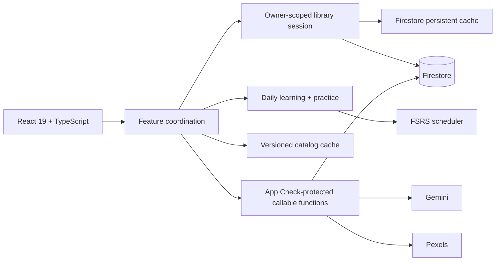

# SonFlash

<p align="center">
  
</p>

<p align="center">
  <strong>Build vivid vocabulary. Review it at exactly the right moment.</strong>
</p>

<p align="center">
  An offline-first English–Vietnamese learning workspace powered by AI-assisted card creation,
  evidence-based spaced repetition, and focused daily practice.
</p>

<p align="center">
  <a href="https://github.com/sonson0910/flash-card/actions/workflows/quality.yml"></a>
  
  
  
  
</p>


## Overview

SonFlash turns a word into a complete learning moment: meaning, pronunciation, context,
examples, related vocabulary, imagery, and a review schedule that adapts to memory strength.
It combines a fast personal vocabulary library with guided daily lessons, targeted practice,
learning paths, and progress insights.

The application is designed around three principles:

- **Memory first** — FSRS scheduling brings each card back when recall needs reinforcement.
- **Offline persistence** — Firestore's persistent cache keeps previously loaded learner
  data available; protected callable mutations require a connection.
- **Secure AI at the boundary** — production AI and image-provider credentials remain in
  App Check-protected Firebase callable functions, never in the browser bundle.

## Product highlights

| Area | What SonFlash provides |
| --- | --- |
| Smart card creation | Gemini-assisted English–Vietnamese definitions, IPA, examples, collocations, synonyms, antonyms, usage notes, and relevant imagery |
| Adaptive review | FSRS-based scheduling, explicit recall ratings, review history, mastery signals, and due-card prioritization |
| Daily learning | Focused sessions for recognition, active recall, spelling, listening, sentence work, and contextual practice |
| Learning paths | Personal progress routes plus versioned, provenance-aware catalog releases with offline activation |
| Offline ownership | Firestore persistent cache, bounded pagination, owner-scoped projections, and safe account switching |
| Library tools | Search, categories, import/export, duplicate handling, private sharing, and responsive card management |
| Progress | XP, memory-strength, category, and learning-state views with accessible alternatives |

On phones, reveal a card before rating it. Swipe right for Good or left for Again, or use the four rating buttons; long answers scroll inside the card. The session recap counts 2 XP per committed review.

Open **Manage library → Appearance settings** to choose Classic or Crystal, follow the
system light/dark setting, or change Lumi, reduced motion and study-sound preferences.
These preferences are saved on this device. Deleting a card offers Undo; restoring it
keeps its learning history. Clearing the entire library requires confirmation and cancels
any pending delete Undo. If a signed-in session expires, recover that session before
protected writes can resume.

## Architecture



The client keeps learner-owned data separate from shared catalog content. Firestore is the
source of truth for signed-in users. Owner-scoped sessions coordinate pagination, cached
projections and owner transitions; protected writes go through authenticated server operations.
Catalog releases are immutable and independently cached so shared content never inherits
private library ownership rules.

Production callable functions validate and bound every external input, enforce ownership and
rate limits, and use Firebase App Check before reaching AI or image providers.

## Technology

- **Application:** React 19, TypeScript 5.8, Vite 6, Tailwind CSS 4
- **Interaction:** Radix UI, Lucide, GSAP
- **Learning:** `ts-fsrs`
- **Cloud:** Firebase Authentication, Firestore, App Check, Hosting, and callable Functions
- **AI and media:** Firebase-protected Google Gemini generation and optional local media providers
- **Quality:** Vitest, Firebase Rules Unit Testing, Playwright, and axe-core

## Getting started

### Requirements

- Node.js `22.x` — the repository rejects unsupported major versions
- npm
- Java 21 when running Firestore Rules or the complete verification suite

### Install and run

```bash
nvm use
npm ci
npm ci --prefix functions
cp .env.example .env.local
npm run dev
```

Open [http://localhost:3000](http://localhost:3000).

AI-assisted card, story, and translation generation uses the protected Firebase callable.
It requires a signed-in Firebase user and client App Check, while Gemini credentials stay
in the server-side Secret Manager. Automated browser tests use isolated emulators as
described below. Pexels and
Unsplash keys remain optional development fallbacks; production never reads provider
secrets from `VITE_*` variables or ships them in the browser bundle.

### Environment variables

| Variable | Scope | Purpose |
| --- | --- | --- |
| `VITE_PEXELS_API_KEY` | Local development, optional | Enables direct Pexels image search |
| `VITE_UNSPLASH_API_KEY` | Local development, optional | Enables the Unsplash fallback |
| `VITE_FIREBASE_APP_CHECK_DEBUG` | Local development only | Enables the Firebase App Check debug-token flow |
| `ENFORCE_APP_CHECK` | Functions deployment | Controls callable App Check enforcement; defaults to enabled |

When using App Check locally, set `VITE_FIREBASE_APP_CHECK_DEBUG=true`, start the app, and
safelist the debug token printed in the browser console. Never commit that token.

## Quality gates

```bash
# Type checking
npm run lint

# Unit and component tests (release tests read the compiled Functions target)
npm --prefix functions run build
npm test -- --run

# Firestore Rules tests (requires Java 21)
npm run test:rules

# Auth, Firestore and Functions emulator journeys in all three browser engines
npm run test:e2e

# Complete release verification
RELEASE_REVISION="$(git rev-parse HEAD)" npm run verify
```

`npm run verify` covers application and Functions type checks, unit tests, Firestore Rules,
the production build, secret and bundle scans, Chromium/Firefox/WebKit journeys, dependency
audits, and release-readiness evidence. `npm run build` also generates the English and Vietnamese
landing pages and sitemap for `https://sonflash.app` from the landing catalogs; `npm run verify`
checks their canonical and reciprocal language links. For release-grade evidence, run it from a clean
checkout and bind it to the exact 40- or 64-character source revision.

Browser commands build into `.e2e-build` and run Auth, Firestore and Functions together,
leaving the production `dist` artifact intact. The runner temporarily disables emulator
App Check and uses invalid AI-provider keys; it restores any existing Functions local
parameter file (or removes one it created) and refuses to replace an existing local secret
file. Java 21 and Playwright browsers are required. If the default Firestore port is
occupied, use a controlled Firebase emulator config through `SONFLASH_E2E_FIREBASE_CONFIG`
and set `VITE_SONFLASH_FIRESTORE_EMULATOR_PORT` to its matching port for the build. Run
root unit tests before browser tests: a release-contract test needs port 4173 itself.

Keep the exact Playwright pin in `package.json` and its matching browser binaries.
Playwright 1.64 includes the upstream WPE compositor filter-transition crash fix
([upstream repair](https://github.com/WebKit/WebKit/pull/73621)); older Linux WebKit
builds can terminate the page while ordinary application transitions run.

Render screenshot goldens with the browser version in the lockfile and the
Ubuntu 24.04 environment used by Quality CI. A different host OS can select
different fallback fonts. On Linux, a version-matched Playwright Noble container
can run the browser server with a read-only project mount; bind it to loopback
and pass its WebSocket URL through `PW_TEST_CONNECT_WS_ENDPOINT` to the emulator
runner. Keep credentials and browser profiles outside the container. The
[typography regression](./e2e/self-hosted-typography.spec.ts) checks the registered
body font on Landing, workspace and Settings; changed goldens still require
visual review followed by an ordinary run without snapshot updates.

Offline release fixtures serve the selected `SONFLASH_BUILD_OUT_DIR` artifact
and authenticate against emulators. Their outage phases stop the app server,
block backend origins, probe backend unavailability and reject successful
backend responses before accepting private-card recovery. WebKit uses an
allowlisted loopback HTTP proxy to close active backend sockets and refuse new
connections, since its service-worker requests bypass Playwright routing.
Chromium also uses
native offline mode and checks a cold profile reopen. Firefox native offline
reload currently fails with `NS_ERROR_OFFLINE`; Firefox and WebKit therefore
verify server-outage recovery separately, without claiming native offline reload
coverage. Firefox still checks the native offline learning guard after recovery.
Cached library-page recovery does not prove persistent Firestore cache support;
Safari and the Firefox emulator use Firestore memory caches.

UI translations use Lingui `msg({ context, message })` descriptors for local copy; the
semantic context stays readable while Lingui generates compact runtime IDs. Keep explicit
`id` values for direct lookups and externally referenced messages. Pass descriptors to
runtime `Trans` with `{...msg(...)}` so production builds remove duplicate defaults.
Changing generated source text changes its ID: run `npm run i18n:extract`, review the en/vi
translations, then run `npm run i18n:check`. Landing loads shell/landing catalogs first;
workspace catalog imports remain lazy. Test fixtures do not contribute Tailwind utilities.

## Production releases

Production deployment is workflow-only. Local production deploys are intentionally not part
of the supported release path.

Public Firebase and App Check configuration is sealed in `firebase-applet-config.json`.
The browser selects a target only from an approved Hosting hostname; unknown deployed
hosts fail closed.

1. [`release-candidate.yml`](./.github/workflows/release-candidate.yml) builds once, verifies
   the exact artifact, and seals revision and digest evidence.
2. [`deploy-staging.yml`](./.github/workflows/deploy-staging.yml) verifies that exact artifact
   against the protected staging target, deploys without rebuilding, and emits a target-bound receipt.
3. [`deploy-production.yml`](./.github/workflows/deploy-production.yml) promotes the verified
   candidate through protected Hosting and Functions environments.
4. [`deploy-firestore-rules.yml`](./.github/workflows/deploy-firestore-rules.yml) performs the
   separately approved Firestore Rules cutover with migration and rollback evidence.

Environment-specific deployment identity belongs in protected GitHub environments.
Staging uses GitHub OIDC Workload Identity Federation through
`GCP_WORKLOAD_IDENTITY_PROVIDER` and `GCP_SERVICE_ACCOUNT`; no long-lived staging key is
stored. Keep target IDs and origins in protected environment variables.

See the [production rollout runbook](./docs/runbooks/phase-6-rollout.md) for candidate
provenance, App Check observation, smoke testing, promotion, and rollback procedures. The
[VN IELTS pilot operations runbook](./docs/runbooks/vn-pilot-operations.md) documents the
isolated staging target, go gates and pilot operations; W0 remains blocked until its smoke is
recorded.

Pilot AI limits and prices are read from the Admin-only Firestore document
`_serviceConfig/pilot` and cached by Functions for 60 seconds. The safe defaults are defined in
[`pilotConfig.ts`](./functions/src/pilotConfig.ts); edit the document only through an authorized
operator action and record the reason in the [pilot decision log](./plans/260923-2000-vn-ielts-paid-pilot/decision-log.md).
Word generation uses a per-account monthly quota and a reusable operation ID; story and translation
use a separate daily allowance. The library and account menu show the current card count. A scheduled
sweeper refunds abandoned word reservations every 15 minutes.
For a read-only cost report, set the explicit `PILOT_TARGET=staging|production`,
`FIREBASE_PROJECT_ID`, `FIRESTORE_DATABASE_ID`,
`PILOT_REPORT_FROM`, `PILOT_REPORT_TO` and `ANALYTICS_PSEUDONYM_KEY` in the operator environment,
then run `node functions/lib/aiCostReportOperator.js` after building Functions. The report prints
daily calls, spend, word-card cost percentiles, timeout share and pseudonymous top accounts;
never paste its secret or raw ledger records into a report.
For pilot Pro access, build Functions and run `node functions/lib/pilotOperator.js` with the same
three target variables, `PILOT_OPERATOR_MODE=grant|revoke|status`, `PILOT_OPERATOR_UID`, and
`PILOT_OPERATOR_CONFIRMATION=<mode>:<target>`. Grant and revoke also require a bounded
`PILOT_OPERATOR_REASON` and `ANALYTICS_PSEUDONYM_KEY`. The tool validates the sealed target
before opening Admin SDK, refuses overlapping grants, and records each mutation in
`operator_audit`. The pilot records purchase intent only; it has no checkout or payment gateway.

## Project map

```text
src/app/                  Application composition and feature coordination
src/features/library/     Owner-scoped library domain and replica
src/features/dailyLearning/ Today, lesson, placement, and progress experiences
src/features/practice/    Quiz, spelling, study, and story sessions
src/features/catalog*/    Catalog validation, cache, and workspace
functions/src/            Protected Firebase callable functions
e2e/                      Cross-browser product and accessibility journeys
docs/architecture/        Architecture decision records
docs/runbooks/            Production operating procedures
```

Start with the [architecture decisions](./docs/architecture/) when changing persistence,
catalog ownership, lesson coordination, releases, or sharing semantics.

## Security notes

Development glob tooling pins the depth-guard derivative of `braces` through the exact
`package.json` override and lockfile integrity. The upstream
[stack-exhaustion advisory](https://github.com/advisories/GHSA-vfj7-8cjw-p6xm) has no patched
upstream release; this is a real guard backport, not an audit exception. The reviewed
[source revision](https://github.com/dieub/braces-depth-guard/tree/305a2e4bfe324bb53c336c1b03387ee1251c926f)
bounds parsed and AST nesting to 100 and rejects cyclic expansion parent chains. It does
not bound expansion cardinality or arbitrary malformed objects. Keep the normal audit
gate and `scripts/braces-depth-guard.test.mjs`; verify registry signatures/provenance with
`npm audit signatures`. Re-evaluate the override when a compatible upstream fix ships.
The client Firebase version stays pinned to the reviewed SDK baseline. Its exact
app-compat override and the Admin SDK database-compat override keep compat services
registered on the same application instance for Rules tests. Revisit these pins together
when upgrading the client SDK, and retain the gRPC security override.


- Provider secrets are server-side in production and scanned out of build artifacts.
- Private cards, progress, queues, and share ownership are scoped to the authenticated UID.
- Shared links are bounded to 100 cards and expire logically at the callable-provided time;
  physical TTL deletion may occur later.
- Catalog publication requires provenance, license, version, checksum, and editorial review
  metadata.
- Destructive migrations and Rules cutovers require revision-bound rollback evidence.

Please avoid reporting sensitive vulnerabilities in public issues. Share only the minimum
reproduction data necessary and never include credentials, private learning content, or
decryption material.
