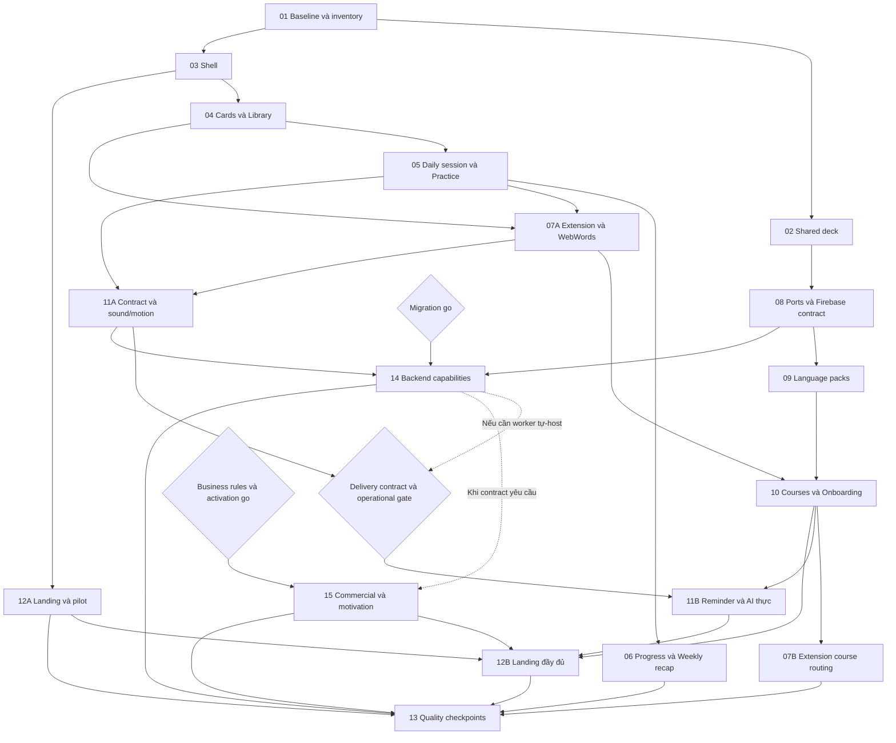

# Thứ tự thực thi và ranh giới hoàn tất

## DAG task/phase

Đường nét đứt là phụ thuộc có điều kiện phải ghi trong contract, không phải quyền bỏ task. Node Q biểu diễn nghiệm thu cuối của13, cần đủ14/15 và mọi board required. Các checkpoint A/B sớm hơn chỉ nghiệm thu phạm vi mốc đã ghi, không đánh dấu toàn13 hoàn tất. 13 không tạo cạnh ngược về implementation. Reviewer cuối kiểm lại phần thay đổi sau mốc trước.

## Subphase để tránh vòng phụ thuộc

| Đơn vị | Task | Điều kiện xong riêng |
|---|---|---|
| 07A | 07.1–07.4,07.6 | Extension thiết kế/i18n, capture nguồn, WebWords và English daily loop hoạt động. |
| 07B | 07.5 | Sau10: mismatch/add/reopen/routing theo course. 07A không chờ07B để giao dữ liệu cho10. |
| 11A | 11.1,11.3 | Reminder/AI contract & delivery decision được ghi; sound/motion settings hoạt động. Contract chưa phải delivery hoàn tất. |
| 11B | 11.2,11.4–11.6 | Push/email/AI/tutor có backend thật và gate vận hành; profile/course context đúng. |
| 12A | 12.1,12.3–12.5 | Landing/pilot surfaces hiện tại đúng thiết kế, dữ liệu/claims thật. |
| 12B | 12.2 và kiểm lại12.4–12.5 | Tất cả sections còn lại nối capabilities thật sau10/11/15. |

Mỗi subphase là một đơn vị review/log/commit. Phase cha vẫn pending/in-progress tới khi đủ cảA/B. Owner có thể duyệt mốc sớm mà không biến các task còn lại thành out-of-scope.

## Các quyết định không được giả định

Owner đã chốt ngày 25/09: được code/test local 08–10 trước G1. G1 vẫn là gate phát hành, không phải điều kiện bắt đầu code local của lane này; migration giữ gate riêng.

Reminder/AI transport được chốt ở11A. Không mặc định phải migrate toàn bộ mới làm được, cũng không giả Firebase có sẵn push/email/streaming contract. Nếu dùng capability ở14, chốt giao diện và phần tối thiểu cần giao;11B vẫn required.

Business gate không bỏ Pricing/Checkout/Referral/League/Streak. Nó chốt giá/quy tắc/quyền bật live. Mọi màn và trạng thái của15 đều được giữ trong inventory.
